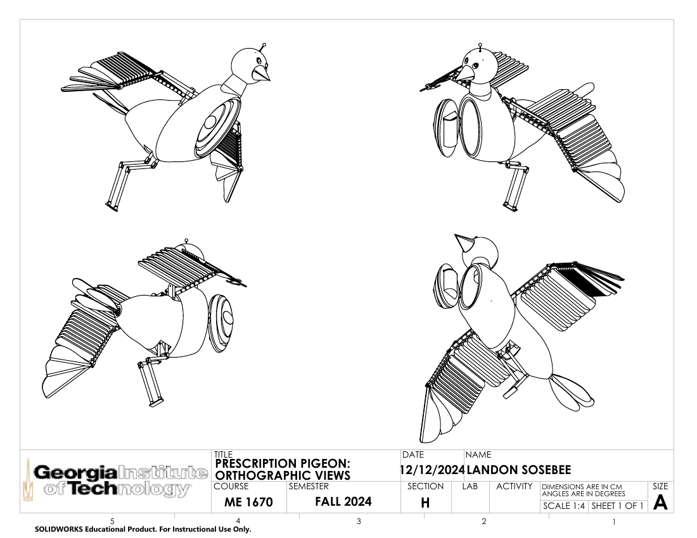
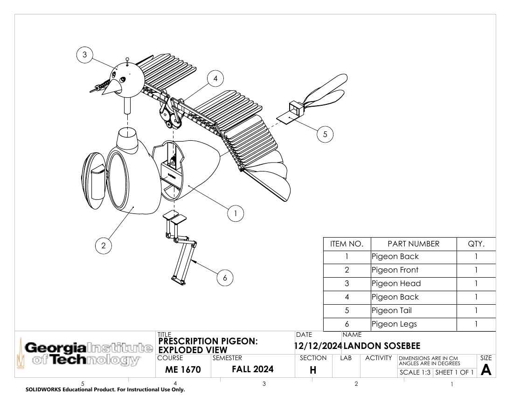
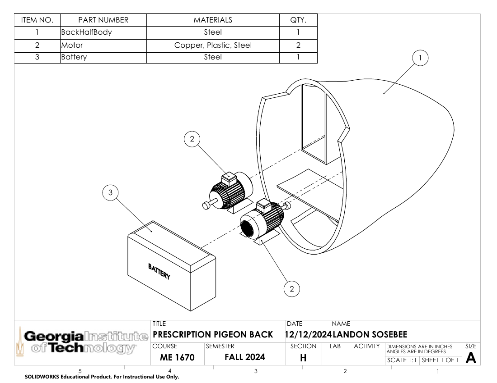
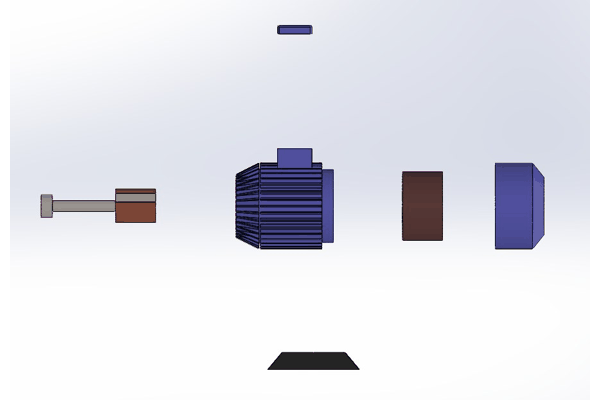
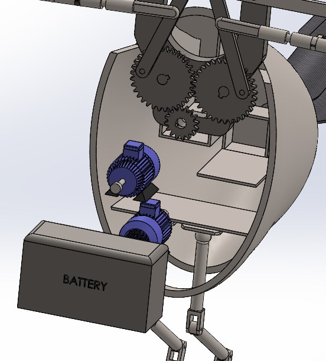
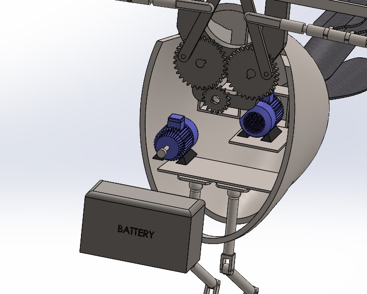
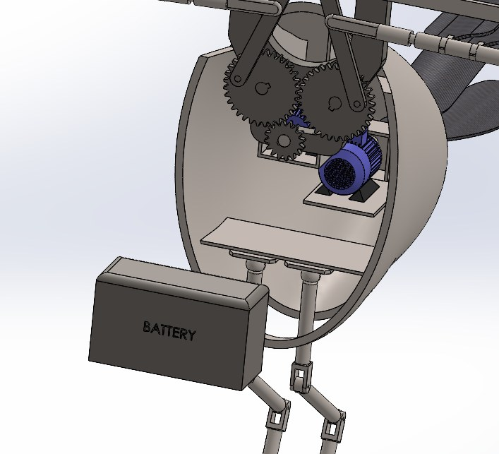
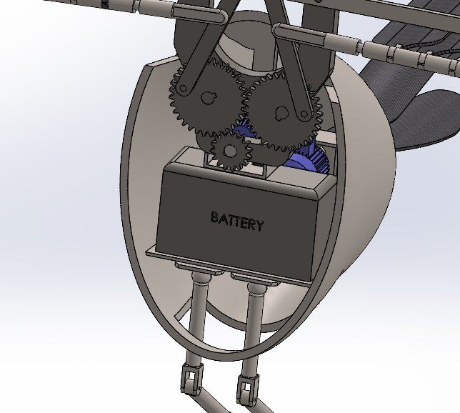
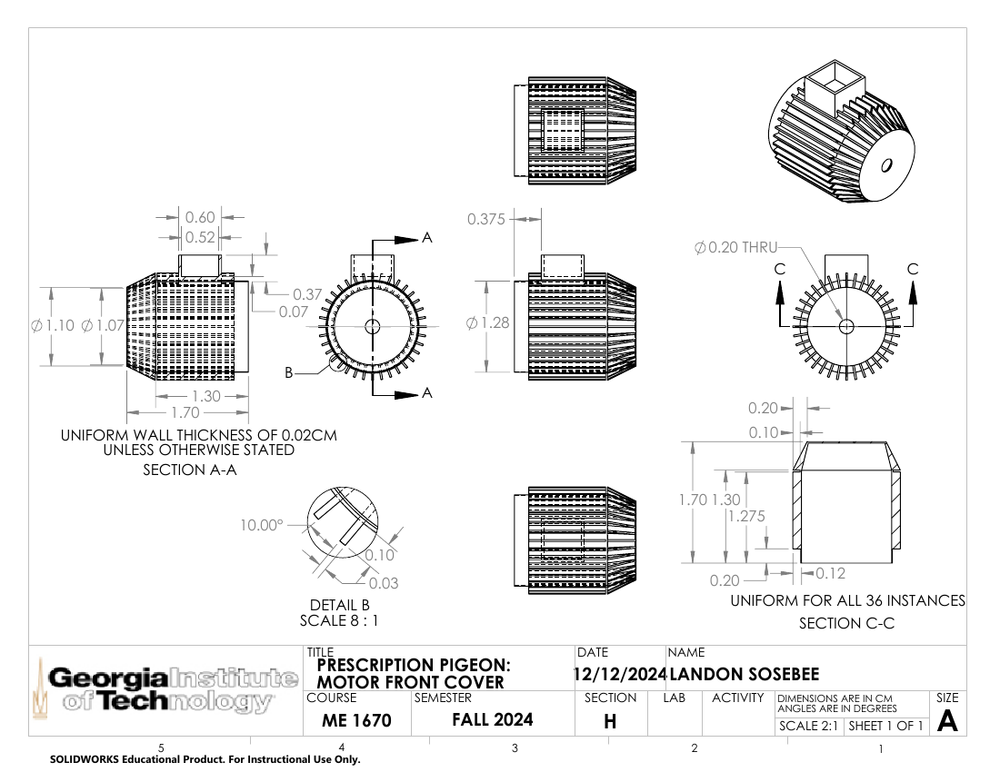

# Prescription Pigeon: Robotic Bird CAD and Drawing Package

**ME 1670: Intro to Engineering Graphics & Visualization · Georgia Tech · Fall 2024**  
**Team project** with ME 1670 classmates

**What it is:** a concept design for a robotic pigeon that delivers prescriptions to people who need them. The bird form was a deliberate choice: in a city, a pigeon blends in where a fleet of delivery drones would stand out. The project was a design exercise in working like an industry team, with each member owning a section of a shared product. It was never meant to be built.

The team split the bird into sections: head, front body, back body, wings, tail, and legs. My work:
- **Back half (my section):** the rear body shell, the drivetrain motors, and the battery, plus packaging them around the wing gear train and producing the drawing package and assembly instructions for that section.
- **System integration:** I put together the **full pigeon assembly** from my teammates' sections and produced the three **top-level drawings** (exploded view with BOM, orthographic views, pictorial views).

## The full assembly

| Exploded view | Back half (my section) |
|---|---|
|  |  |

## Motor sub-assembly

I modeled the motor as six parts: front cover, top cover (terminal box), back cover, rotor, stator, and mounting stand.
- **Front cover:** 36 cooling fins made with a circular pattern, with a uniform wall shelled out
- **Back cover:** a vent grid of 127 square holes
- **Rotor and stator** modeled as separate parts so the assembly could be exploded and documented

## Packaging iterations

The hard part of this section was fitting two motors and a battery inside a curved shell without hitting the gear train that drives the wings. I tried several layouts:

| | |
|---|---|
|  |  |
|  |  |

**Final layout:** one motor on a platform at the tail, driving the tail gear, a second motor on a platform under the wings, driving the wing gear train, and the battery on a platform above the legs.

> *These are packaging and layout models. The motors are positioned at the gear train, but the shaft-to-gear connection isn't modeled as a working drivetrain.*

## Drawing package

14 sheets in total, organized top-down from the full bird to individual parts.

**Full pigeon**
- [Exploded view + BOM](drawings/full-pigeon/1_Pigeon_Exploded_View.pdf)
- [Orthographic views](drawings/full-pigeon/2_Pigeon_Orthographic_Views.pdf)
- [Pictorial views](drawings/full-pigeon/3_Pigeon_Pictorial_Views.pdf)

**Back half (mine)**

| Assembly level | Part level |
|---|---|
| [1: Back outline](drawings/back-half/1_Pigeon_Back_Outline.pdf) | [6: Motor front cover](drawings/back-half/6_Motor_Front_Cover.pdf) |
| [2: Back exploded + BOM](drawings/back-half/2_Pigeon_Back_Exploded.pdf) | [7: Motor top cover](drawings/back-half/7_Motor_Top_Cover.pdf) |
| [3: Back half body](drawings/back-half/3_Back_Half_Body.pdf) | [8: Motor back cover](drawings/back-half/8_Motor_Back_Cover.pdf) |
| [4: Battery](drawings/back-half/4_Battery.pdf) | [9: Motor rotor](drawings/back-half/9_Motor_Rotor.pdf) |
| [5: Motor exploded + BOM](drawings/back-half/5_Motor_Exploded.pdf) | [10: Motor stator](drawings/back-half/10_Motor_Stator.pdf) |
| | [11: Motor stand](drawings/back-half/11_Motor_Stand.pdf) |

The part drawings use section views (A-A, B-B, C-C), a scaled detail view, pattern callouts (36 fins, 127 vent holes), and general wall thickness notes.

## Assembly instructions

I also wrote [step-by-step assembly instructions](docs/Pigeon_Back_Assembly_Instructions.pdf) for the back half: building up each motor, mounting the motors to the stands and the body platforms, and installing the battery.

> **[REMOVE ONCE FIXED]** *Known drawing issues: (1) the back-half exploded sheet says inches while every other sheet is in cm; (2) the motor cover wall thickness note reads 0.02 cm (0.2 mm), too thin for a real plastic part; (3) the back BOM has "Motor Motor Rotor"; (4) the full-pigeon BOM lists "Pigeon Back" twice; (5) the pictorial views sheet is titled "Orthographic Views."*

## Files
- `drawings/`: all 14 drawing PDFs
- `cad/solidworks/`: native SolidWorks parts and assemblies for the back half
- `docs/`: assembly instructions

## Tools
SolidWorks (part modeling, assemblies, exploded views, drawings) · Technical documentation
